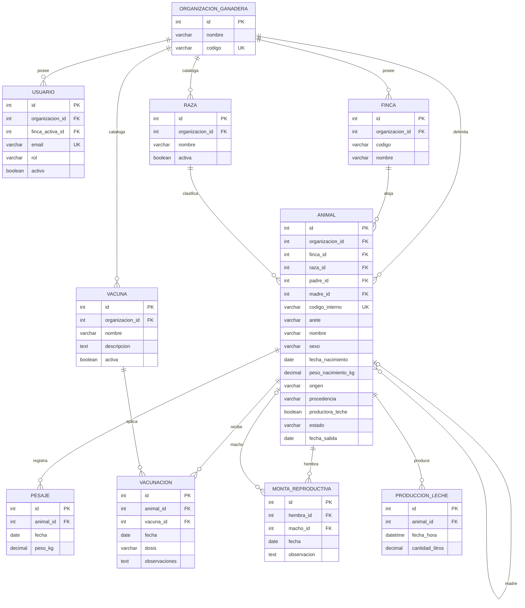

# Modelo de datos del MVP

Este documento es la línea base de persistencia de BOVITRACK V1. El esquema se
implementa antes de continuar con las verticales funcionales para que cada issue
posterior conecte formularios, permisos y consultas sobre una estructura estable.

## Diagrama entidad-relación

Todas las tablas incluyen `creado_por`, `fecha_creacion`, `actualizado_por` y
`fecha_actualizacion`. Las referencias de auditoría son anulables para permitir
el alta inicial y conservar registros cuando se desactiva o retira un usuario.

## Restricciones estructurales

| Regla | Implementación |
|---|---|
| Organización única | `organizacion_ganadera.codigo` único global |
| Usuario único | `usuario.email` único global |
| Finca única | `(organizacion_id, codigo)` único |
| Catálogos sin duplicados | `(organizacion_id, nombre)` único en raza y vacuna |
| Animal identificable | `codigo_interno` único global; `(organizacion_id, arete)` único cuando hay arete |
| Pesaje diario | `(animal_id, fecha)` único |
| Historial conservado | relaciones operativas usan `ON DELETE RESTRICT` |
| Catálogos usados | se desactivan con `activa`; no se eliminan físicamente |
| Genealogía | `padre_id` y `madre_id` apuntan a `animal`; no existe tabla de genealogía |
| Producción diaria | se calcula sumando `cantidad_litros`; no existe tabla de totales |
| Historial integral | se consulta desde las cuatro tablas operativas; no se duplica |

## Reglas que requieren dominio y pruebas

La base garantiza claves, nulabilidad, relaciones y unicidad. Doctrine y el
dominio validan las reglas que abarcan varias filas o tablas:

- la finca, raza, vacuna y progenitores pertenecen a la organización del animal;
- padre es macho, madre es hembra y ningún animal es su propio progenitor;
- solo una hembra puede marcarse como productora de leche;
- pesajes y eventos no preceden al nacimiento ni superan la fecha de salida;
- una monta relaciona una hembra con un macho de la misma organización;
- una vacunación utiliza una vacuna activa de la misma organización;
- la producción de leche es positiva y pertenece a una hembra productora.

## Orden de implementación

1. Aplicar la migración completa en desarrollo y en `bovitrack_test`.
2. Ejecutar validación de mapeo y sincronización de Doctrine.
3. Ejecutar pruebas unitarias de dominio y pruebas de integración de restricciones.
4. Continuar las issues #12–#21 conectando repositorios, casos de uso e interfaz.

Una issue funcional no puede redefinir el esquema silenciosamente. Todo cambio
posterior al modelo exige migración, actualización de este diagrama y una prueba
de regresión de base de datos.
